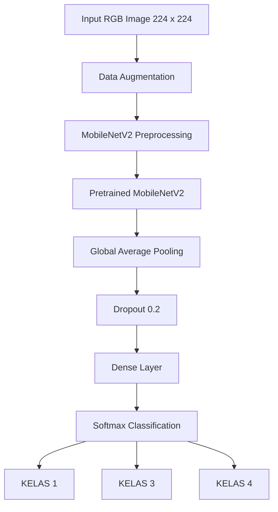

# 🧠 MobileNetV2 Model Architecture

## 1. Overview

This project implements MobileNetV2 with transfer
learning for Pakcoy plant growth stage classification.

The model is developed using TensorFlow and Keras
and trained in Google Colab with GPU acceleration.

## 2. Model Configuration

| Parameter | Configuration |
|---|---|
| Architecture | MobileNetV2 |
| Learning Method | Transfer Learning |
| Pretrained Weights | ImageNet |
| Input Shape | 224 x 224 x 3 |
| Batch Size | 16 |
| Output Classes | 3 |
| Optimizer | Adam |
| Learning Rate | 0.001 |
| Activation | Softmax |
| Dropout | 0.2 |
| Epochs | 20 |
| Framework | TensorFlow 2.21.0 |

## 3. Model Architecture Workflow

## 4. Model Layers

| Layer | Output Shape | Parameters |
|---|---|---:|
| Input Layer | 224 x 224 x 3 | 0 |
| Data Augmentation | 224 x 224 x 3 | 0 |
| Preprocessing | 224 x 224 x 3 | 0 |
| MobileNetV2 | 7 x 7 x 1280 | 2,257,984 |
| Global Average Pooling | 1280 | 0 |
| Dropout | 1280 | 0 |
| Dense Softmax | 3 | 3,843 |

## 5. Model Parameters

| Parameter Type | Total |
|---|---:|
| Total Parameters | 2,261,827 |
| Trainable Parameters | 3,843 |
| Non-Trainable Parameters | 2,257,984 |

The pretrained MobileNetV2 backbone is frozen
during training.

Only the final classification layer is trained
to recognize the available Pakcoy classes.

## 6. Data Augmentation

The model applies the following augmentation
techniques during training:

- Random horizontal flip
- Random rotation: 0.05
- Random contrast: 0.10

MobileNetV2 preprocessing is applied before
feature extraction.

## 7. Model Compilation

The model uses the following configuration:

- Optimizer: Adam
- Learning rate: 0.001
- Loss: Sparse Categorical Crossentropy
- Evaluation metric: Accuracy

## 8. Training Callbacks

### Early Stopping

- Monitor: Validation loss
- Patience: 5 epochs
- Restore best weights: True

### Model Checkpoint

- Monitor: Validation accuracy
- Save best model: True
- Output: pakcoy_demo_3kelas.keras

## 9. Classification Classes

The current model recognizes three classes:

| Index | Class |
|---:|---|
| 0 | KELAS 1 |
| 1 | KELAS 3 |
| 2 | KELAS 4 |

KELAS 2 is excluded because no training images
are currently available for this class.

## 10. Experimental Performance

| Metric | Result |
|---|---:|
| Training Images | 456 |
| Validation Images | 76 |
| Testing Images | 76 |
| Final Training Accuracy | 99.78% |
| Final Validation Accuracy | 100% |
| Test Accuracy | 100% |
| Test Loss | 0.0020 |
| Precision | 1.0000 |
| Recall | 1.0000 |
| F1-Score | 1.0000 |

The reported results are limited to the current
three-class experimental dataset.

Further independent testing and data leakage
checks are required to assess generalization.

## 11. Model Export

The trained model is exported into:

- pakcoy_demo_3kelas.keras
- pakcoy_demo_3kelas.tflite
- class_names_demo.json

These files are intended for further development
and future deployment.

## 12. Future Development

- Complete the missing KELAS 2 dataset.
- Develop a four-class classification model.
- Verify plant age labels.
- Perform independent field testing.
- Explore model fine-tuning.
- Deploy the model in a virtual machine.
- Integrate the model with smart farming systems.

## 13. Project Status

- Model architecture: Completed
- Three-class training: Completed
- Experimental evaluation: Completed
- Keras export: Completed
- TensorFlow Lite export: Completed
- Four-class training: Pending
- Deployment: Pending
