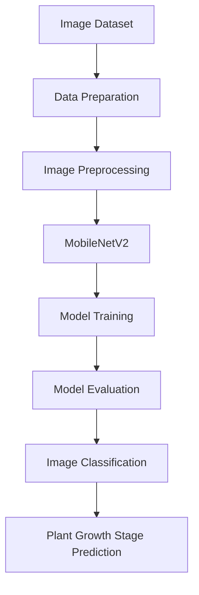

# 🌱 Pakcoy Age Detection Using MobileNetV2

## 📌 Project Overview

This project focuses on detecting and classifying the growth stages of Pakcoy plants using Deep Learning and the MobileNetV2 architecture.

The project applies image classification and transfer learning techniques to identify plant growth stages based on visual characteristics.

Model development and training are conducted using Google Colab.

## 🎯 Project Objectives

- Develop a plant age classification model.
- Apply transfer learning using MobileNetV2.
- Perform image preprocessing and data preparation.
- Train and evaluate a deep learning model.
- Support smart farming and agricultural monitoring.
- Prepare the model for future system integration.

## 🛠️ Technologies Used

| Technology | Description |
|---|---|
| Python | Programming language |
| TensorFlow | Deep learning framework |
| Keras | Model development |
| MobileNetV2 | Transfer learning architecture |
| NumPy | Numerical computation |
| Matplotlib | Data visualization |
| Google Colab | Model training environment |
| GitHub | Source code management |

## 📂 Dataset

The dataset consists of Pakcoy plant images categorized according to their growth stages.

Dataset preparation includes:

- Image collection
- Image labeling
- Image resizing
- Image normalization
- Training and validation data preparation

## 🧠 Model Architecture

MobileNetV2 is a lightweight deep learning architecture designed for efficient image classification.

The transfer learning approach is used to take advantage of pretrained image features and adapt them to the Pakcoy classification task.

## 🔄 Project Workflow

## 🚀 How to Run

1. Open the notebook file in this repository.
2. Open the notebook using Google Colab.
3. Select the GPU runtime.
4. Upload or connect the dataset.
5. Run the notebook cells sequentially.
6. Train and evaluate the model.
7. Test the model using Pakcoy images.

## 📓 Project Notebook

- `Pakcoy_Classification.ipynb`

## 📊 Model Evaluation

The model can be evaluated using:

- Training Accuracy
- Validation Accuracy
- Training Loss
- Validation Loss
- Confusion Matrix
- Classification Report

Evaluation results will be updated based on the completed training process.

## 🔮 Future Development

- Real-time Pakcoy image classification.
- Model integration with IoT devices.
- Deployment in a virtual machine environment.
- Automated plant growth monitoring.
- Smart farming application development.

## 👩‍💻 Developer

**Tania Panjaitan**

Computer Technology | Machine Learning | IoT | Software Development

GitHub: https://github.com/taniapanjaitan7-hub

## 📌 Project Status

Under Development

## ⭐ Acknowledgements

This project was developed for educational purposes and practical implementation of Machine Learning in smart agriculture.
