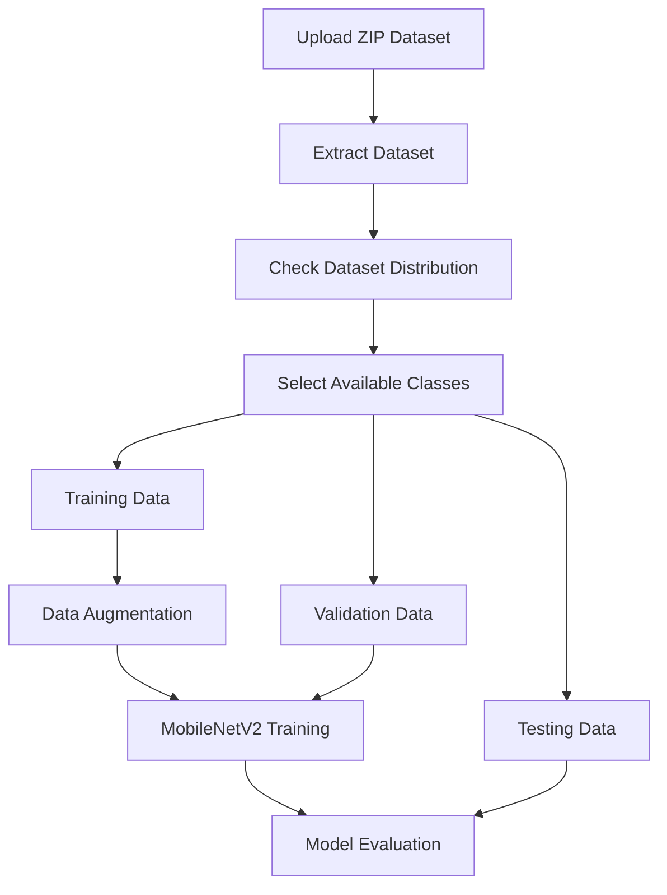

# 🌱 Pakcoy Image Dataset Documentation

## 1. Dataset Overview

This dataset is used to develop a Pakcoy plant
growth stage classification model using MobileNetV2
and transfer learning.

The dataset is processed and used for model
training, validation, and testing in Google Colab.

## 2. Dataset Information

| Attribute | Description |
|---|---|
| Dataset | Pakcoy Plant Images |
| Dataset Version | 2026-11-26 |
| Original File | dataset_pakcoy_v2026-11-26.zip |
| Total Images | 608 |
| Original Classes | 4 |
| Active Classes | 3 |
| Model Architecture | MobileNetV2 |
| Input Image Size | 224 x 224 pixels |
| Color Channels | RGB |
| Batch Size | 16 |
| Training Platform | Google Colab |
| Framework | TensorFlow 2.21.0 |

## 3. Dataset Distribution

| Class | Training | Validation | Testing | Total |
|---|---:|---:|---:|---:|
| KELAS 1 | 240 | 36 | 44 | 320 |
| KELAS 2 | 0 | 0 | 0 | 0 |
| KELAS 3 | 120 | 24 | 16 | 160 |
| KELAS 4 | 96 | 16 | 16 | 128 |
| Total | 456 | 76 | 76 | 608 |

## 4. Dataset Splitting

- Training dataset: 456 images (75%)
- Validation dataset: 76 images (12.5%)
- Testing dataset: 76 images (12.5%)

## 5. Active Classification Classes

The current demonstration model uses three classes:

- KELAS 1
- KELAS 3
- KELAS 4

KELAS 2 is excluded from the current training
process because no images are available for
this class.

The exact age ranges associated with the class
labels require further verification.

## 6. Dataset Directory Structure

```text
pakcoy_demo_3kelas/
├── latih/
│   ├── KELAS 1/
│   ├── KELAS 3/
│   └── KELAS 4/
├── validasi/
│   ├── KELAS 1/
│   ├── KELAS 3/
│   └── KELAS 4/
└── uji/
    ├── KELAS 1/
    ├── KELAS 3/
    └── KELAS 4/
```

## 7. Dataset Preparation

The dataset preparation process includes:

1. Uploading the ZIP dataset to Google Colab.
2. Extracting the dataset.
3. Checking the number of images in each class.
4. Selecting three available classes.
5. Preparing training, validation, and testing data.
6. Resizing images to 224 x 224 pixels.
7. Loading images using TensorFlow.

## 8. Data Augmentation

The following augmentation techniques are applied:

| Technique | Configuration |
|---|---|
| Random Horizontal Flip | Enabled |
| Random Rotation | 0.05 |
| Random Contrast | 0.10 |
| Preprocessing | MobileNetV2 preprocess_input |

Data augmentation is used during model training
to improve image variation and model robustness.

## 9. Dataset Processing Workflow



## 10. Experimental Results

| Metric | Result |
|---|---:|
| Training Epochs | 20 |
| Final Training Accuracy | 99.78% |
| Final Validation Accuracy | 100% |
| Test Accuracy | 100% |
| Test Loss | 0.0020 |
| Precision | 1.0000 |
| Recall | 1.0000 |
| F1-Score | 1.0000 |
| Testing Images | 76 |

These results represent the current three-class
experimental dataset and should not be interpreted
as guaranteed performance on unseen field images.

## 11. Confusion Matrix

| Actual / Predicted | KELAS 1 | KELAS 3 | KELAS 4 |
|---|---:|---:|---:|
| KELAS 1 | 44 | 0 | 0 |
| KELAS 3 | 0 | 16 | 0 |
| KELAS 4 | 0 | 0 | 16 |

## 12. Model Output Files

The trained model produces the following files:

- pakcoy_demo_3kelas.keras
- pakcoy_demo_3kelas.tflite
- class_names_demo.json

These files support further model development
and future deployment.

## 13. Dataset Limitations

- KELAS 2 does not currently contain images.
- The number of images differs between classes.
- Class age ranges require further verification.
- Additional independent testing is required.
- Potential duplicate images and data leakage
  should be checked before final evaluation.

## 14. Future Improvements

- Collect images for KELAS 2.
- Verify plant age labels.
- Increase dataset diversity.
- Improve class balance.
- Evaluate the model using independent images.
- Develop a four-class classification model.
- Deploy the model for smart farming applications.

## 15. Project Status

- Dataset preparation: Completed for three classes
- Image preprocessing: Completed
- Model training: Completed for three classes
- Model evaluation: Completed for current test set
- Keras model export: Completed
- TensorFlow Lite export: Completed
- Four-class model: Pending
- Deployment: Pending

## 16. Project Repository

Machine-Learning-Colab

https://github.com/taniapanjaitan7-hub/Machine-Learning-Colab
