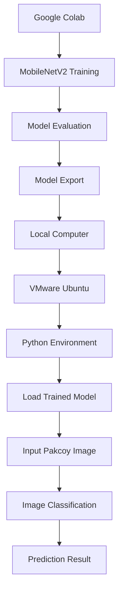

# 🚀 MobileNetV2 Deployment Guide

## 1. Deployment Overview

This document provides a proposed deployment
guide for the Pakcoy plant classification model
using MobileNetV2.

The model is trained in Google Colab and prepared
for deployment in a virtual machine environment.

## 2. System Configuration

| Component | Technology |
|---|---|
| Training Platform | Google Colab |
| Virtualization | VMware |
| Proposed Operating System | Ubuntu Linux |
| Programming Language | Python |
| Framework | TensorFlow |
| Model Architecture | MobileNetV2 |
| Model Format | Keras and TensorFlow Lite |
| Input Image Size | 224 x 224 pixels |
| Output Classes | 3 |

## 3. Exported Model Files

The following files were generated during
the Google Colab experiment:

| File | Description |
|---|---|
| pakcoy_demo_3kelas.keras | Trained Keras model |
| pakcoy_demo_3kelas.tflite | TensorFlow Lite model |
| class_names_demo.json | Classification labels |

## 4. Deployment Architecture



## 5. Proposed Deployment Directory

```text
pakcoy-deployment/
├── models/
│   ├── pakcoy_demo_3kelas.keras
│   ├── pakcoy_demo_3kelas.tflite
│   └── class_names_demo.json
├── images/
│   └── sample.jpg
├── predict.py
└── requirements.txt
```

## 6. Environment Preparation

Open the Ubuntu terminal inside VMware.

Update the package list:

```bash
sudo apt update
```

Install Python and virtual environment support:

```bash
sudo apt install python3 python3-pip python3-venv -y
```

Create the project directory:

```bash
mkdir -p pakcoy-deployment/models
mkdir -p pakcoy-deployment/images
cd pakcoy-deployment
```

Create a virtual environment:

```bash
python3 -m venv venv
source venv/bin/activate
```

Install the required libraries:

```bash
python -m pip install --upgrade pip
python -m pip install tensorflow numpy pillow
```

TensorFlow installation requires a compatible
Python version and system architecture.

## 7. Model Preparation

Download the exported model files from
Google Colab.

Transfer the following files into the models
directory inside VMware:

- pakcoy_demo_3kelas.keras
- pakcoy_demo_3kelas.tflite
- class_names_demo.json

Prepare a sample Pakcoy image and save it
as images/sample.jpg.

## 8. Image Prediction

Create a Python file named predict.py.

```python
import json
import numpy as np
import tensorflow as tf

MODEL_PATH = "models/pakcoy_demo_3kelas.keras"
CLASS_PATH = "models/class_names_demo.json"
IMAGE_PATH = "images/sample.jpg"

model = tf.keras.models.load_model(
    MODEL_PATH,
    compile=False
)

with open(CLASS_PATH, "r") as file:
    class_names = json.load(file)

image = tf.keras.utils.load_img(
    IMAGE_PATH,
    target_size=(224, 224)
)

image_array = tf.keras.utils.img_to_array(image)
image_array = np.expand_dims(image_array, axis=0)

predictions = model.predict(
    image_array,
    verbose=0
)

class_index = np.argmax(predictions[0])
confidence = float(np.max(predictions[0])) * 100

print("==============================")
print("PAKCOY CLASSIFICATION RESULT")
print("==============================")
print("Predicted Class:", class_names[class_index])
print(f"Confidence: {confidence:.2f}%")
```

The exported Keras model already includes
MobileNetV2 preprocessing. Additional input
normalization is not required.

## 9. Running the Model

Execute the following command:

```bash
python predict.py
```

The program will display the predicted class
and model confidence for the input image.

## 10. Classification Labels

| Index | Class |
|---:|---|
| 0 | KELAS 1 |
| 1 | KELAS 3 |
| 2 | KELAS 4 |

KELAS 2 is not supported by the current
experimental model because no training
images are available for this class.

## 11. Experimental Performance

| Metric | Result |
|---|---:|
| Test Accuracy | 100% |
| Test Loss | 0.0020 |
| Precision | 1.0000 |
| Recall | 1.0000 |
| F1-Score | 1.0000 |
| Testing Images | 76 |

These results were obtained in Google Colab,
not in the VMware deployment environment.

## 12. Deployment Validation

The following tests should be completed:

- Verify Python and TensorFlow installation.
- Verify successful model loading.
- Verify image preprocessing.
- Test classification using sample images.
- Compare VMware and Google Colab predictions.
- Measure inference execution time.
- Evaluate independent field images.
- Evaluate TensorFlow Lite inference.

## 13. Future Development

- Complete the KELAS 2 dataset.
- Develop a four-class classification model.
- Optimize TensorFlow Lite inference.
- Implement real-time camera classification.
- Integrate with IoT devices.
- Develop an agricultural monitoring dashboard.
- Support smart farming applications.

## 14. Deployment Status

| Component | Status |
|---|---|
| Dataset Preparation | Completed for 3 classes |
| Model Training | Completed |
| Model Evaluation | Completed in Colab |
| Keras Export | Completed |
| TensorFlow Lite Export | Completed |
| VMware Deployment | Pending verification |
| Independent Field Testing | Pending |
| IoT Integration | Planned |

## 15. Related Documentation

- [Dataset Documentation](DATASET.md)
- [Training Documentation](TRAINING.md)
- [Evaluation Documentation](EVALUATION.md)
- [Model Architecture](../MODEL_ARCHITECTURE.md)
