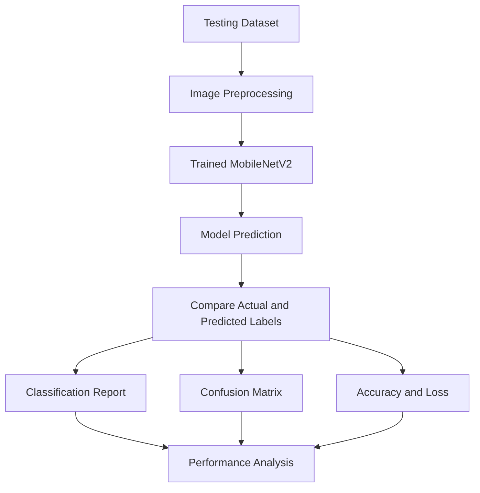

# 📊 MobileNetV2 Model Evaluation

## 1. Evaluation Overview

This document presents the experimental evaluation
of the MobileNetV2 model developed for Pakcoy plant
growth stage classification.

The evaluation is conducted using TensorFlow,
Keras, and Scikit-learn in Google Colab.

## 2. Testing Dataset

| Class | Testing Images |
|---|---:|
| KELAS 1 | 44 |
| KELAS 3 | 16 |
| KELAS 4 | 16 |
| Total | 76 |

The current experimental model uses three classes.
KELAS 2 is excluded because no images are available.

## 3. Evaluation Metrics

The model is evaluated using:

- Accuracy
- Loss
- Precision
- Recall
- F1-Score
- Confusion Matrix
- Classification Report

## 4. Evaluation Results

| Metric | Result |
|---|---:|
| Test Accuracy | 100.00% |
| Test Loss | 0.0020 |
| Precision | 1.0000 |
| Recall | 1.0000 |
| F1-Score | 1.0000 |
| Total Testing Images | 76 |
| Correct Predictions | 76 |
| Incorrect Predictions | 0 |

## 5. Classification Report

| Class | Precision | Recall | F1-Score | Support |
|---|---:|---:|---:|---:|
| KELAS 1 | 1.0000 | 1.0000 | 1.0000 | 44 |
| KELAS 3 | 1.0000 | 1.0000 | 1.0000 | 16 |
| KELAS 4 | 1.0000 | 1.0000 | 1.0000 | 16 |
| Macro Average | 1.0000 | 1.0000 | 1.0000 | 76 |
| Weighted Average | 1.0000 | 1.0000 | 1.0000 | 76 |

## 6. Confusion Matrix

| Actual / Predicted | KELAS 1 | KELAS 3 | KELAS 4 |
|---|---:|---:|---:|
| KELAS 1 | 44 | 0 | 0 |
| KELAS 3 | 0 | 16 | 0 |
| KELAS 4 | 0 | 0 | 16 |

The confusion matrix shows that all 76 testing
images were correctly classified in the current
experimental evaluation.

## 7. Training and Validation Performance

| Metric | Result |
|---|---:|
| Final Training Accuracy | 99.78% |
| Final Training Loss | 0.0059 |
| Final Validation Accuracy | 100% |
| Final Validation Loss | 0.0041 |
| Lowest Validation Loss | 0.0018 |
| Best Validation Loss Epoch | 19 |
| Total Epochs | 20 |

## 8. Evaluation Workflow

## 9. Performance Analysis

The MobileNetV2 model achieved 100% accuracy
on the current testing dataset of 76 images.

The classification report indicates perfect
precision, recall, and F1-score for the three
available classes in this experiment.

However, these results do not guarantee equivalent
performance on new images collected under
different environmental conditions.

## 10. Model Limitations

- KELAS 2 is not included in the current model.
- The testing dataset contains only 76 images.
- Dataset distribution is not balanced.
- Actual plant age ranges require verification.
- Independent field testing is still required.
- Potential duplicate images and data leakage
  require further investigation.

## 11. Exported Model Files

The following files were generated:

| File | Description |
|---|---|
| pakcoy_demo_3kelas.keras | Trained Keras model |
| pakcoy_demo_3kelas.tflite | TensorFlow Lite model |
| class_names_demo.json | Classification labels |

## 12. Future Development

- Collect additional Pakcoy images.
- Complete the KELAS 2 dataset.
- Improve dataset quality and diversity.
- Verify model generalization.
- Evaluate the TensorFlow Lite model.
- Develop a four-class classification system.
- Deploy the model using VMware.
- Integrate with smart farming and IoT systems.

## 13. Conclusion

The MobileNetV2 model has successfully completed
three-class experimental training and evaluation.

The model achieved 100% accuracy on the available
testing dataset.

Further evaluation is required before deployment
in real-world agricultural environments.

## 14. Related Documentation

- [Dataset Documentation](DATASET.md)
- [Training Documentation](TRAINING.md)
- [Model Architecture](../MODEL_ARCHITECTURE.md)
