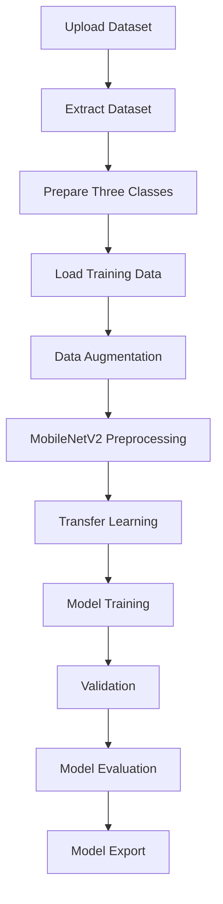

# 🚀 MobileNetV2 Training Documentation

## 1. Training Overview

This project implements transfer learning using
MobileNetV2 to classify Pakcoy plant growth stages.

The model is trained using TensorFlow and Keras
in Google Colab with GPU acceleration.

## 2. Training Environment

| Component | Configuration |
|---|---|
| Platform | Google Colab |
| Framework | TensorFlow 2.21.0 |
| Hardware | GPU |
| Language | Python |
| Architecture | MobileNetV2 |
| Pretrained Weights | ImageNet |

## 3. Dataset Configuration

| Dataset | Number of Images |
|---|---:|
| Training | 456 |
| Validation | 76 |
| Testing | 76 |
| Total | 608 |

The current model uses three active classes:

- KELAS 1
- KELAS 3
- KELAS 4

KELAS 2 is excluded because no images are available.

## 4. Training Parameters

| Parameter | Value |
|---|---|
| Image Size | 224 x 224 pixels |
| Color Channels | RGB |
| Batch Size | 16 |
| Epochs | 20 |
| Optimizer | Adam |
| Learning Rate | 0.001 |
| Dropout | 0.2 |
| Activation | Softmax |
| Loss Function | Sparse Categorical Crossentropy |
| Trainable Parameters | 3,843 |
| Non-Trainable Parameters | 2,257,984 |
| Total Parameters | 2,261,827 |

## 5. Training Workflow

## 6. Training Callbacks

### Early Stopping

- Monitor: Validation Loss
- Patience: 5 epochs
- Restore Best Weights: True

### Model Checkpoint

- Monitor: Validation Accuracy
- Save Best Only: True
- Filename: pakcoy_demo_3kelas.keras

## 7. Training History

| Epoch | Training Accuracy | Training Loss | Validation Accuracy | Validation Loss |
|---:|---:|---:|---:|---:|
| 1 | 84.43% | 0.4174 | 98.68% | 0.0589 |
| 2 | 98.25% | 0.0716 | 100% | 0.0251 |
| 3 | 99.34% | 0.0433 | 100% | 0.0174 |
| 4 | 100% | 0.0222 | 100% | 0.0117 |
| 5 | 100% | 0.0208 | 100% | 0.0094 |
| 6 | 100% | 0.0145 | 100% | 0.0076 |
| 7 | 100% | 0.0116 | 100% | 0.0058 |
| 8 | 100% | 0.0098 | 100% | 0.0052 |
| 9 | 99.78% | 0.0103 | 100% | 0.0045 |
| 10 | 100% | 0.0091 | 100% | 0.0037 |
| 11 | 100% | 0.0068 | 100% | 0.0034 |
| 12 | 100% | 0.0060 | 100% | 0.0028 |
| 13 | 100% | 0.0048 | 100% | 0.0026 |
| 14 | 99.78% | 0.0064 | 100% | 0.0031 |
| 15 | 100% | 0.0039 | 100% | 0.0023 |
| 16 | 100% | 0.0034 | 100% | 0.0022 |
| 17 | 100% | 0.0039 | 100% | 0.0027 |
| 18 | 100% | 0.0037 | 100% | 0.0019 |
| 19 | 100% | 0.0025 | 100% | 0.0018 |
| 20 | 99.78% | 0.0059 | 100% | 0.0041 |

## 8. Final Training Results

| Metric | Result |
|---|---:|
| Final Training Accuracy | 99.78% |
| Final Training Loss | 0.0059 |
| Final Validation Accuracy | 100% |
| Final Validation Loss | 0.0041 |
| Lowest Validation Loss | 0.0018 |
| Best Validation Loss Epoch | 19 |
| Test Accuracy | 100% |
| Test Loss | 0.0020 |

## 9. Training Analysis

The training accuracy increased significantly
during the initial training epochs.

The validation accuracy reached 100% at epoch 2.

The lowest validation loss was recorded at epoch 19.

The training results demonstrate strong performance
on the current three-class experimental dataset.

However, further independent testing is required
to verify model generalization and identify
potential dataset leakage or duplicate images.

## 10. Model Export

The following output files were generated:

- pakcoy_demo_3kelas.keras
- pakcoy_demo_3kelas.tflite
- class_names_demo.json

These files can be used for further model
development and future deployment.

## 11. Future Improvements

- Collect missing KELAS 2 images.
- Verify plant age labels.
- Improve dataset balance.
- Perform independent field testing.
- Explore MobileNetV2 fine-tuning.
- Train a complete four-class model.
- Deploy the model using VMware.
- Integrate the model with smart farming systems.

## 12. Training Status

- Dataset preparation: Completed
- Model architecture: Completed
- Three-class model training: Completed
- Experimental evaluation: Completed
- Model export: Completed
- Four-class training: Pending
- VMware deployment: Pending
